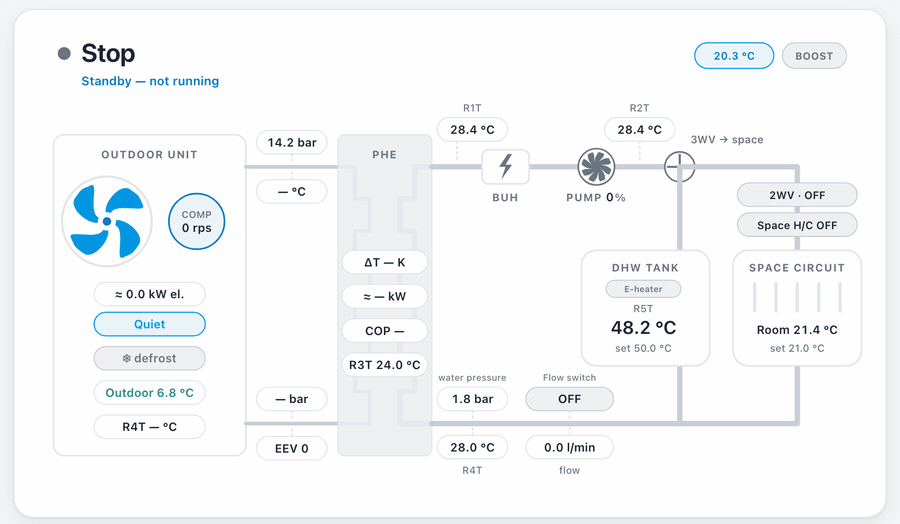

# daikin-altherma-esp32

ESP-IDF firmware for ESP32-S3 boards that reads a **Daikin Altherma** heat pump through its
**X10A** service port. View live readings in the local web UI and publish them to Home Assistant
through MQTT. An optional HomeHub connection provides a separate read-only Modbus source.

## Requirements

- A Daikin Altherma with an X10A header.
- A supported ESP32-S3 board with at least **8 MB flash**.
- An X10A cable: **JST-EH 2.5 mm, 5-pin** connector, two signal wires and common ground.
- USB power and a browser supporting Web Serial for installation.

## Setup

1. Choose your [board](docs/BOARDS.md) and follow the [safe wiring guide](docs/WIRING.md).
2. Install with the [web installer](https://0bu.github.io/daikin-altherma-esp32/).
3. Join `daikin-altherma-esp32-setup`, then enter your home WiFi at `http://192.168.4.1`.
4. Rejoin your home network and open `http://daikin-altherma-esp32.local`.
5. Set your board under **Settings → ESP32 → Hardware** and the wired RX/TX pins under
   **Settings → Protocol**. Set the broker under **Settings → Connections → MQTT** if needed.

The [setup guide](docs/SETUP.md) covers each step and how to check that it worked.

## UI

View live values, operating states, local history and optional [plant diagnostics](docs/DIAGNOSTICS.md);
unestablished readings appear as `—`.

## Documentation

[Documentation index](docs/README.md) · [Home Assistant](docs/HOME_ASSISTANT.md) ·
[Report a bug](docs/REPORTING.md) · [Contributing](CONTRIBUTING.md)

## Scope & credits

The firmware reads the heat pump; it does not control it. Keep the unauthenticated HTTP API on a
trusted LAN ([security model](docs/SECURITY.md)).

[MIT](LICENSE). Protocol and value definitions derived from
[ESPAltherma](https://github.com/raomin/ESPAltherma) (MIT); see [third-party notices](THIRD_PARTY_NOTICES.md).
No warranty; not affiliated with Daikin.
