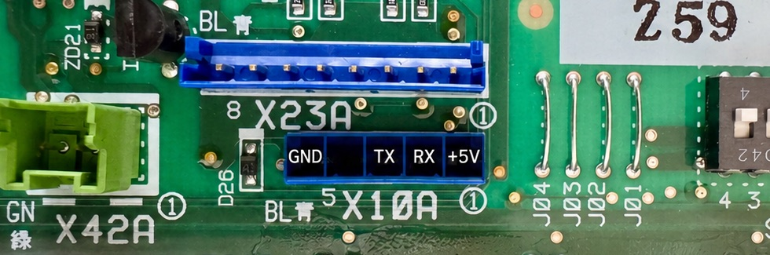

# X10A wiring

Switch the heat pump **off at the breaker** before connecting or changing the cable. Identify the
header and its pin numbering from the unit's service documentation. Cable colours alone do not
establish pin identity.

## Voltage and wiring

X10A uses **5 V TTL**; ESP32 GPIOs are 3.3 V and are not officially 5 V tolerant. Protect the
**HP-TX → ESP32-RX** input with a suitable divider, for example 10 kΩ from HP-TX to ESP32-RX and
20 kΩ from ESP32-RX to common ground. An auto-direction shifter such as TXS0108E can prevent UART
communication; do not use it as a substitute for a suitable UART input-level circuit.

The ESP32's 3.3 V TX signal is accepted by the documented X10A TTL RX path. **Common ground is
mandatory**, including when USB powers the board.

Prefer **USB power** and leave X10A pin 1 insulated and disconnected. Daikin rates X10A at
**5 V / 50 mA** in the [EKPCCAB installation manual](https://www.daikin.co.uk/content/dam/document-library/installation-manuals/ctrl/EKPCCAB4_4PW74106-1E_2018_06_Installation%20manual.pdf).
An ESP32 exceeds this rating; powering it from X10A is outside that specification.



| X10A pin | Signal | Daikin harness colour | ESP32 connection |
|---:|---|---|---|
| 1 | +5 V | Red | Leave disconnected with USB power. |
| 2 | HP-TX | Brown | **RX** GPIO, through input-level protection. |
| 3 | HP-RX | Green | **TX** GPIO. |
| 4 | NC | — | Leave disconnected and insulated. |
| 5 | GND | Black | **GND**, always. |

## Visual wiring diagram — M5Stack AtomS3 Lite (Grove)

Select **RX1 / TX2** under **Settings → Protocol**. The shipped defaults are 44/43, which this
board does not expose. A Grove cable needs three connected wires when USB powers the board:

```text
Daikin X10A                     Grove breakout           AtomS3 Lite
2  HP-TX ── input divider ────── yellow ───────────────── G1 / GPIO1 (RX)
3  HP-RX ─────────────────────── white ────────────────── G2 / GPIO2 (TX)
5  GND ───────────────────────── black ────────────────── GND
1  +5 V                         red: disconnected
4  NC                           disconnected
```

Grove colours follow the standard cable; verify a non-standard adapter by connector position.
Without Grove, use two offered side-header GPIOs, for example RX5 / TX6. The available pads and
accessory conflicts are listed once in [BOARDS.md](BOARDS.md).

### The cable chain, connector by connector

Use a **JST-EH 2.5 mm 5-pin pigtail** at X10A and a **Grove HY2.0-4P breakout** at the AtomS3 Lite.
Female 2.54 mm jumper sockets on the pigtail can meet male 2.54 mm breakout pins without cutting
either cable:

```text
X10A → JST-EH pigtail → individual female/male jumper joints → Grove breakout → board
```

Make the joints **wire by wire**. X10A order is `5V, HP-TX, HP-RX, NC, GND`; Grove order is
`GND, 5V, G2, G1`. Joining multi-way housings straight across gives the wrong mapping. Purchased
pigtail colours are arbitrary: identify pin 1, verify continuity with a multimeter while unpowered,
then insulate the unused 5 V and NC ends. Include the input divider in the HP-TX/RX path.

### Same wiring on a Seeed XIAO ESP32-S3

| X10A | XIAO |
|---|---|
| Pin 2 HP-TX, through input protection | **D7 / GPIO44 (RX)** |
| Pin 3 HP-RX | **D6 / GPIO43 (TX)** |
| Pin 5 GND | **GND** |

These are the firmware defaults, so a fresh XIAO wired this way needs no RX/TX change. Leave pin 1
disconnected with USB power.

## Bi-Zone modules and the X12A port

With an EKMIK/EKMIKC Bi-Zone or secondary mixing PCB, an internal harness may already occupy the
main PCB's X10A port. Community installations have instead used **X12A on the Bi-Zone PCB**, with
a JST-EH 2.5 mm 5-pin connector and the same serial framing/polling.

The reported pinout mirrors X10A: **1 +5 V, 2 HP-TX, 3 HP-RX, 4 NC, 5 GND**. This is community
evidence, **not an official pinout confirmed across PCB revisions**. Before connecting an ESP32,
verify connector orientation, voltages and polarity with a digital multimeter, especially pin 1
(+5 V) and pin 5 (GND). Apply the same input protection and USB-power wiring above. Do not proceed
from connector shape or cable colours alone; a power/signal mix-up can damage the board.

## Picking pins on a different board

Choose two distinct, physically exposed GPIOs from the **Settings → Protocol** dropdown. The
chip-safe filter excludes flash/PSRAM, strapping, USB console and dedicated-JTAG pads. A selected
preset further restricts it to the board's actual headers; configured peripherals, ENV III and
detected Ethernet remove occupied pins.

With **Custom**, the firmware knows chip reservations but cannot know your PCB routing. Compare
the list with that board's schematic. On a Waveshare ESP32-S3-DevKitC-1, the typical eligible set is
GPIO1/2/4–18/35–38/43/44/47/48, subject to the actual flash/PSRAM build and occupied pins.
GPIO0/3/45/46 are straps, 19/20 are the USB console, 39–42 are dedicated JTAG, and the default
indicator uses GPIO21.

Detection tries the saved pair, the default pair and both exchanged orders. **It never scans all
GPIOs.** Swapping the two signal wires is recoverable through detection; mixing a signal with 5 V
or ground is unsafe. GPIO16/17 from classic ESP32 examples are not broken out on the two presets.

## Check the link

Restore power after checking the wiring. An online link and readable values establish communication;
they do not independently prove that every decoded measurement is physically correct.

If it remains offline, verify the selected GPIOs, pin numbering, common ground and continuity with
power removed. `Timeout` and `Wrong CRC` suggest a link-quality problem without identifying its
cause. A reply `0x15 0xEA` rejects that request; the firmware also tries the older `S` protocol.
For persistent problems, collect the [device report](REPORTING.md) and include the actual wiring.

## Status LED and recovery button

Configure these under **Settings → ESP32 → Hardware**, following the single
[board inventory](BOARDS.md). The local-peripheral picker also allows dedicated-JTAG pins because
AtomS3 Lite's button uses GPIO41. Leave absent hardware on **None**. A configured recovery button
can erase settings and evidence; read [the reset contract](BOARDS.md#recovery-button) before using it.
